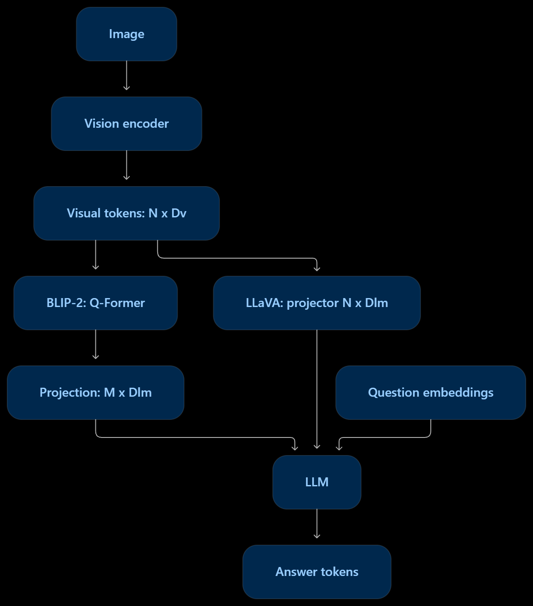

# bridge_and_qwen3vl_inference — ব্রিজের ধারণা, খেলনা টেনসর দিয়ে প্রমাণ

র‍্যান্ডম ভিজ্যুয়াল টোকেন দিয়ে দেখানো হয়: ছবির টোকেনকে কীভাবে (ক) গড় করে, (খ) Q-Former-এর মতো কুয়েরি দিয়ে, আর (গ) LLaVA-র মতো প্রজেক্টর দিয়ে LLM-এর ভাষায় বদলানো হয় — আর ফ্রিজ করা মডেলে শুধু ব্রিজ/প্রজেক্টরই শেখে, বাকিটা বদলায় না।

## ১.৫. চিহ্নের তালিকা — এগুলো ছাড়া আকারগুলো অর্থহীন

হ্যাঁ, এগুলোও গুরুত্বপূর্ণ — তাই নোটে যোগ করা হলো। নোটবুক আর ডায়াগ্রামে বারবার `N × Dv`, `M × Dlm` লেখা থাকে; এই তালিকা না জানলে বোঝা যাবে না কোন অক্ষরটা কী বোঝাচ্ছে।

| চিহ্ন | অর্থ | মান |
|---|---|---:|
| `B` | Batch-এ ছবির সংখ্যা | 2 |
| `N` | প্রতি ছবির visual tokens | 6 |
| `Dv` | প্রতিটি visual token-এর feature dimension | 8 |
| `M` | Learnable queries-এর সংখ্যা | 3 |
| `Dq` | Query hidden dimension | 12 |
| `Dlm` | LLM input embedding dimension | 16 |

কোথায় কোনটা ব্যবহৃত হয়, সেটা মিলিয়ে নাও:

- `B × N × Dv = 2 × 6 × 8` — ভিজ্যুয়াল টোকেনের আকার (সেল ১)।
- `M × Dq = 3 × 12` — কুয়েরি ফিচারের আকার, অর্থাৎ MiniQueryBridge-এর আউটপুট `[2, 3, 12]`।
- `Dq → Dlm`, অর্থাৎ ১২ → ১৬ — BLIP-স্টাইল `q_to_lm` লিনিয়ার, প্রিফিক্স `[2, 3, 16]`।
- `Dv → Dlm`, অর্থাৎ ৮ → ১৬ — LLaVA-স্টাইল MLP প্রজেক্টর, প্রিফিক্স `[2, 6, 16]`।
- টেক্সট এমবেডিংও `Dlm = 16` মাত্রায় হয়, তাই ভিজ্যুয়াল প্রিফিক্স আর টেক্সট একসাথে জোড়া যায়: BLIP `[2, 7, 16]`, LLaVA `[2, 10, 16]`।

## ২. Flow

```text
ভিজ্যুয়াল টোকেন (খেলনা): [2, 6, 8]   (ব্যাচ ২, টোকেন ৬, মাত্রা ৮)
   ├─ গড় করলে → [2, 8]              (ক্রম হারিয়ে যায়)
   ├─ MiniQueryBridge (কুয়েরি) → [2, 3, 12]  (টোকেন সংখ্যা ফিক্সড ৩)
   │     ↓ Linear 12→16
   │   BLIP-স্টাইল প্রিফিক্স [2, 3, 16] + টেক্সট [2, 4, 16] = ইনপুট [2, 7, 16]
   └─ LLaVA প্রজেক্টর (MLP) → [2, 6, 16] + টেক্সট [2, 4, 16] = ইনপুট [2, 10, 16]
                                              ↓
                                   ফ্রিজ করা LM ব্লক → লজিট → লস → গ্রেডিয়েন্ট
                                              ↓
                        শুধু ব্রিজ + প্রজেক্টর বদলায়, ফ্রিজ করা অংশ বদলায় না
```

মাথায় রাখার ছবি: ব্রিজের কাজ ভাষা শেখানো না, **অনুবাদ করা** — ছবির ভেক্টরকে LLM যে মাত্রা আর ভাষা বোঝে, সেই মাত্রায় নিয়ে আসা।

## ২.৫. ডায়াগ্রামটা — নোটের জন্য কেন গুরুত্বপূর্ণ



ডায়াগ্রাম পড়ার নিয়ম, এক বাক্স করে:

- **Image → Vision encoder → Visual tokens: N × Dv** — নোটবুকের সেল ১-এর `[2, 6, 8]`-এর সাথে মেলাও: এখানে N = ৬, Dv = ৮।
- **বাম শাখা — BLIP-2: Q-Former → Projection: M × Dlm** — নোটবুকের MiniQueryBridge (কুয়েরি M = ৩) আর `q_to_lm` (১২ → ১৬) মিলে প্রিফিক্স `[2, 3, 16]` বানায়। টোকেন সংখ্যা N থেকে M-এ নেমে আসে।
- **ডান শাখা — LLaVA: projection N × Dlm** — নোটবুকের MLP প্রজেক্টর (৮ → ১৬) প্রতিটা ভিজ্যুয়াল টোকেনকে আলাদাভাবে বদলায়, তাই প্রিফিক্স `[2, 6, 16]` — টোকেন সংখ্যা N-ই থেকে যায়।
- **Question embeddings** — ডায়াগ্রামের প্রশ্নের দিকটা নোটবুকের `text_features [2, 4, 16]`-এর সাথে মেলে। তবে মনে রাখো, নোটবুকে টেক্সট আইডিগুলো আর্বিট্রারি (`[1, 2, 3, 4]`), আসল প্রশ্ন না।
- **LLM → Answer tokens** — দুই শাখার যেকোনো একটা থেকে আসা প্রিফিক্স আর প্রশ্ন একসাথে LLM-এ ঢোকে, LLM উত্তর টোকেন বানায়।

দুটো সতর্কতা, ডায়াগ্রাম দেখে ভুল না হয় সেজন্য:

1. ডায়াগ্রামে দুই শাখাই LLM-এর দিকে তীর দিয়ে আঁকা, কিন্তু **আসল মডেলে একসাথে দুটো শাখা চলে না** — একটা মডেল হয় BLIP-স্টাইল, নয় LLaVA-স্টাইল। এটা "এই দুই রাস্তার যেকোনো একটা" বোঝায়, "দুটোই একসাথে" না।
2. ডায়াগ্রামে যা **নেই**, তা নোটবুকেই আছে: গড় (mean pooling), অ্যাটেনশন টয়, অ্যালাইনমেন্ট টয়, আর ফ্রিজ করা ট্রেনিংয়ের প্রমাণ। আর নোটবুকে যা **নেই**, তা ডায়াগ্রামে আছে: আসল উত্তর তৈরি (generation) — নোটবুক শুধু শেষ টোকেনের লজিট পর্যন্ত যায়, পুরো উত্তর লেখে না। তাই ডায়াগ্রাম আর নোট একে অপরের পরিপূরক, কোনোটাই একা পুরো ছবি না।

## ৩. ধাপে ধাপে কোডের প্রবাহ

### ধাপ ০ — সেটআপ

- `torch.manual_seed(42)`, প্রিন্টে ৩ দশমিক। সব টেনসর র‍্যান্ডম — এখানে কোনো আসল ছবি বা অর্থ নেই, শুধু আকার আর প্রবাহ পরীক্ষা করা হচ্ছে।
- আকারের নাম: `B=2, N=6, Dv=8` (ব্যাচ, ভিজ্যুয়াল টোকেন, ভিশন মাত্রা), `M=3, Dq=12, Dlm=16` (কুয়েরি সংখ্যা, কুয়েরি মাত্রা, LLM মাত্রা)।

### ধাপ ১ — গড় (Mean Pooling) আর ক্রম হারানো

- `visual_tokens = torch.randn(B, N, Dv)` → `[2, 6, 8]`।
- `summary = visual_tokens.mean(dim=1)` → `[2, 8]`।
- টোকেনের ক্রম উল্টে (`flip(1)`) আবার গড় করলেও ফল একই থাকে: `Mean unchanged after reordering: True`।
- শিক্ষা: গড় করলে টোকেন সংখ্যা কমে, কিন্তু **কোন টোকেন কোথায় ছিল, সেই অবস্থানের তথ্য হারিয়ে যায়**। তাই শুধু গড় দিয়ে সূক্ষ্ম স্থানিক (spatial) কাজ করা যায় না।

### ধাপ ২ — অ্যাটেনশন, ছোট সংখ্যা দিয়ে

- সূত্র (মার্কডাউন সেলে দেওয়া): $\operatorname{Attention}(Q, K, V) = \operatorname{softmax}\left(\frac{QK^\top}{\sqrt{d_k}}\right)V$।
- টয় সংখ্যা: Q `[2, 2]`, K `[3, 2]`, V `[3, 2]`। $\sqrt{d_k} = \sqrt{2}$ দিয়ে ভাগ করে Softmax।
- ফল: ওয়েট `[[0.576, 0.140, 0.284], [0.140, 0.576, 0.284]]`, কনটেক্সট `[[7.180, 2.820], [2.820, 7.180]]`, প্রতিটা সারির ওয়েটের যোগফল ১।
- শিক্ষা: অ্যাটেনশন মানে **ওজন দিয়ে গড় করা** — কোন V কতটা নেওয়া হবে, সেটা Q আর K-র মিল ঠিক করে। ওয়েটের যোগফল ১ হওয়া Softmax-এর ধর্ম, মডেলের গুণ না।

### ধাপ ৩ — MiniQueryBridge (Q-Former-এর মতো, সরল সংস্করণ)

- `class MiniQueryBridge(nn.Module)` — এটা আসল BLIP-2 Q-Former না, তার **সরল ধারণা**।
- ভেতরে যা আছে:
  - শেখার মতো কুয়েরি: `nn.Parameter(torch.randn(1, M, Dq) * 0.02)` → `[1, 3, 12]`। ছোট মান (০.০২) দিয়ে শুরু, যাতে প্রথমে কুয়েরিগুলো প্রায় একরকম না হয়ে যায়।
  - Self-attention: `nn.MultiheadAttention(Dq=12, 3 heads)` — কুয়েরিগুলো নিজেদের মধ্যে কথা বলে।
  - Cross-attention: `nn.MultiheadAttention(Dq=12, 3 heads, kdim=Dv=8, vdim=Dv=8)` — কুয়েরি Q হয়, ভিজ্যুয়াল টোকেন K আর V হয়। এখানেই ছবির তথ্য কুয়েরিতে ঢোকে।
  - তিনটি `LayerNorm` আর FFN: `Linear(12 → 24) → GELU → Linear(24 → 12)`।
- `forward()`-এর ক্রম (প্রতিটা ধাপে residual + norm):
  1. কুয়েরি ব্যাচে ছড়িয়ে দেওয়া (`expand`): `[2, 3, 12]`।
  2. Self-attention + residual + `norm1`।
  3. Cross-attention (ছবি থেকে তথ্য নেওয়া) + residual + `norm2`।
  4. FFN + residual + `norm3`।
- ফল: `Query features: (2, 3, 12)`, `Attention map: (2, 3, 6)` — অর্থাৎ ৩টি কুয়েরি × ৬টি ভিজ্যুয়াল টোকেন।
- সবচেয়ে গুরুত্বপূর্ণ পরীক্ষা: ভিজ্যুয়াল টোকেন ৬ থেকে ১০ করলেও আউটপুট একই থাকে `[2, 3, 12]`। **কুয়েরি সংখ্যা M ফিক্সড, তাই LLM-এ যাওয়া টোকেন সংখ্যাও ফিক্সড** — ছবি যত বড়ই হোক, ব্রিজের আউটপুট বাড়ে না। এটাই Q-Former-স্টাইল ব্রিজের মূল সুবিধা।

### ধাপ ৪ — BLIP-স্টাইল বনাম LLaVA-স্টাইল প্রিফিক্স

- BLIP-স্টাইল: `q_to_lm = nn.Linear(Dq=12, Dlm=16)` কুয়েরি ফিচারে লাগিয়ে → প্রিফিক্স `[2, 3, 16]`।
- LLaVA-স্টাইল প্রজেক্টর: `Sequential(Linear(Dv=8, Dlm=16), GELU, Linear(16, 16))` সরাসরি ভিজ্যুয়াল টোকেনে লাগিয়ে → প্রিফিক্স `[2, 6, 16]`। এখানে প্রতিটা ভিজ্যুয়াল টোকেন আলাদাভাবে প্রজেক্ট হয়, টোকেন সংখ্যা কমে না।
- টেক্সট: `nn.Embedding(20, 16)` (ফ্রিজ করা, কিন্তু র‍্যান্ডম — এর কোনো ভাষাগত অর্থ নেই), `text_ids = [[1, 2, 3, 4], [1, 5, 3, 4]]` → টেক্সট ফিচার `[2, 4, 16]`।
- একসাথে জোড়া (`cat`, dim=1):
  - BLIP-স্টাইল ইনপুট: `[2, 7, 16]` (৩ ভিজ্যুয়াল + ৪ টেক্সট)।
  - LLaVA-স্টাইল ইনপুট: `[2, 10, 16]` (৬ ভিজ্যুয়াল + ৪ টেক্সট)।
- শিক্ষা: এই খেলনা উদাহরণে LLaVA ইনপুট ৩ টোকেন লম্বা। আসল মডেলে এই পার্থক্য অনেক বড় হয় — শত শত ভিজ্যুয়াল টোকেন বনাম ৩২/৬৪টি কুয়েরি। তাই BLIP-স্টাইল সস্তা (কম টোকেন), কিন্তু সূক্ষ্ম বিবরণ হারাতে পারে; LLaVA-স্টাইল বিবরণ রাখে, কিন্তু LLM-এর ইনপুট লম্বা হয়, গতি আর মেমোরি খরচ বাড়ে।

### ধাপ ৫ — অ্যালাইনমেন্ট শেখা, সবচেয়ে ছোট উদাহরণ

- ভিশন ভেক্টর: `eye(2)` (পরিচয় ম্যাট্রিক্স), ভাষার ভেক্টর: `[[0, 1], [1, 0]]` (দুটো অক্ষ অদলবদল)।
- অ্যালাইনার: `Linear(2, 2, bias=False)`, ওজন শুরুতে পরিচয় ম্যাট্রিক্স, অপটিমাইজার SGD, lr=0.5, ৪০ ধাপ।
- ফল: MSE লস ১.০ থেকে ১.০১৩e-১০-এ নামে, অ্যালাইন করা ভেক্টর ভাষার ভেক্টরের মতো হয়ে যায়।
- শিক্ষা: প্রজেক্টর শেখা মানে জাদু না, একটা **ম্যাপিং শেখা** — ভিশন স্পেসের ভেক্টরকে ভাষার স্পেসের কাছাকাছি নিয়ে আসা। তবে মনে রাখো: এই উদাহরণ ইচ্ছা করে এত সহজ বানানো যে সমাধানটা শুধু অক্ষ অদলবদল — আসল অ্যালাইনমেন্টে হাজার হাজার ছবি-লেখা জোড়া লাগে, একটা ২×২ ম্যাট্রিক্সে হয় না।

### ধাপ ৬ — ফ্রিজ করা মডেলে শুধু ব্রিজ শেখে (সবচেয়ে দরকারি প্রমাণ)

- ফ্রিজ করা অংশ: `vision_stub` (Linear 8→8), `lm_block` (TransformerEncoderLayer: d_model=16, 4 heads, feedforward=32, dropout=0), `lm_head` (Linear 16→10)। তিনটিতেই `requires_grad_(False)` আর `.eval()`।
- ফ্রিজ করার আগে সব প্যারামিটারের কপি রাখা হয় (`frozen_before`) — পরে তুলনা করার জন্য।
- অপটিমাইজার: Adam, lr=0.01, শুধু `bridge.parameters() + q_to_lm.parameters()` — ফ্রিজ করা অংশ অপটিমাইজারে নেই।
- এক ধাপ: ভিশন স্টাব → ব্রিজ → প্রজেক্টর → টেক্সটের সাথে জোড়া → causal mask (`triu(1)`, ভবিষ্যৎ টোকেন দেখা যাবে না) দিয়ে LM ব্লক → শেষ টোকেনের hidden থেকে লজিট → CrossEntropy, টার্গেট `[2, 7]` (আর্বিট্রারি ক্লাস, ১০টির মধ্যে)।
- ফল (সবই প্রমাণ হিসেবে ছাপানো):
  - `Queries received gradient: True`
  - `Projection updated: True`
  - `Frozen parameters received gradients: False`
  - `Frozen weights unchanged: True`
- শিক্ষা: ফ্রিজ মানে মডেলটা শুধু সামনে হিসাব করে (forward), পেছনে শেখে না (backward-এ গ্রেডিয়েন্ট পায় না, ওজন বদলায় না)। এটাই BLIP-2-এর কৌশলের ভিত্তি: বড় vision encoder আর LLM ফ্রিজ রেখে শুধু ছোট ব্রিজটা শেখানো — কম মেমোরি, কম সময়। তবে এখানে LM ব্লকটা আসল LLM না, একটা ছোট Transformer লেয়ার — ধারণাটা এক, স্কেলটা খেলনা।

## ৪. মূল ফলাফল (সেটিংসহ)

- টেনসর আকার: ভিজ্যুয়াল `[2, 6, 8]`, গড় `[2, 8]`, কুয়েরি ফিচার `[2, 3, 12]`, অ্যাটেনশন ম্যাপ `[2, 3, 6]`; ১০ টোকেনেও কুয়েরি আউটপুট `[2, 3, 12]`।
- প্রিফিক্স: BLIP-স্টাইল `[2, 3, 16]`, LLaVA-স্টাইল `[2, 6, 16]`; মোট ইনপুট BLIP `[2, 7, 16]`, LLaVA `[2, 10, 16]`।
- অ্যাটেনশন টয়: ওয়েট `[[0.576, 0.140, 0.284], [0.140, 0.576, 0.284]]`, সারির যোগফল ১।
- অ্যালাইনমেন্ট টয়: MSE ১.০ → ১.০১৩e-১০ (SGD, lr=0.5, ৪০ ধাপ)।
- ফ্রিজ পরীক্ষা: কুয়েরি গ্রেডিয়েন্ট পেয়েছে, প্রজেক্টর বদলেছে, ফ্রিজ করা প্যারামিটার গ্রেডিয়েন্ট পায়নি, ওজন বদলায়নি।

## ৫. ভুল/ফাঁদ/সতর্কতা

1. **নাম দেখে ভুল ধারণা:** ফাইলের নামে Qwen3-VL লেখা থাকলেও এখানে Qwen নেই। এই নোট পড়ে "Qwen ইনফারেন্স শিখেছি" বলা যাবে না — ব্রিজের ধারণা শিখেছি বলতে হবে।
2. **খেলনা টেনসরকে আসল ছবি ভাবা:** `torch.randn` দিয়ে বানানো ভেক্টরের কোনো অর্থ নেই। কুয়েরি, অ্যাটেনশন ম্যাপ, লস — সবই আকার আর প্রবাহের প্রমাণ, মডেলের বোঝার প্রমাণ না।
3. **MiniQueryBridge = আসল Q-Former ভাবা:** আসল Q-Former-এ আরও লেয়ার, টেক্সট কন্ডিশনিং, আর প্রশিক্ষণের ধাপ আছে। এটা তার সরল ছায়া মাত্র।
4. **অ্যালাইনমেন্টের সহজ উদাহরণকে আসল ভাবা:** ২×২ অক্ষ অদলবদল ৪০ ধাপে শেখা যায়, আসল ভিশন-ভাষা অ্যালাইনমেন্টে তা যায় না।
5. **ফ্রিজ মানে "ব্যবহার হয় না" ভাবা:** ফ্রিজ করা অংশ forward-এ পুরোপুরি কাজ করে, শুধু ওজন বদলায় না। eval() আর dropout=0 এখানে একসাথে থাকায় বিভ্রান্তি হতে পারে — dropout=0 হলে এমনিতেই ড্রপআউট হয় না, eval() আলাদা কারণে দেওয়া।
6. **টার্গেট `[2, 7]`-কে অর্থপূর্ণ ভাবা:** এটা আর্বিট্রারি ক্লাস নম্বর, কোনো আসল উত্তর না। লসের মান এখানে গুরুত্বপূর্ণ না, গ্রেডিয়েন্ট কোথায় গেল সেটাই গুরুত্বপূর্ণ।
7. **টোকেন সংখ্যার পার্থক্যকে ছোট ভাবা:** খেলনায় পার্থক্য ৩ টোকেন, আসলে শত শত টোকেন হতে পারে — সেখানেই BLIP বনাম LLaVA-র খরচের পার্থক্য তৈরি হয়।

## ৬. ৫ মিনিটে মনে করার চেকলিস্ট

- গড় করলে টোকেন কমে, কিন্তু ক্রম/অবস্থান হারিয়ে যায়।
- অ্যাটেনশন = ওজন দিয়ে গড়, ওয়েটের যোগফল ১।
- কুয়েরি ব্রিজ: ভিজ্যুয়াল টোকেন যতই বাড়ুক, আউটপুট টোকেন ফিক্সড (এখানে ৩)।
- BLIP প্রিফিক্স ছোট (৩), LLaVA প্রিফিক্স বড় (৬) — খরচ বনাম বিবরণের ট্রেড-অফ।
- প্রজেক্টর শেখা = ভিশন স্পেস থেকে ভাষা স্পেসে ম্যাপিং শেখা।
- ফ্রিজ করা অংশ গ্রেডিয়েন্ট পায় না, ওজন বদলায় না; শুধু ব্রিজ/প্রজেক্টর শেখে।
- ডায়াগ্রাম পড়তে: একটা মডেলে একটাই শাখা — BLIP হলে M টোকেন, LLaVA হলে N টোকেন; দুটো একসাথে না।

## ৭. নিজেকে যাচাই

1. ভিজ্যুয়াল টোকেন ৬ থেকে ১০ করলেও কুয়েরি আউটপুট `[2, 3, 12]`-ই থাকল কেন?
   - উত্তর: কারণ আউটপুটের টোকেন সংখ্যা কুয়েরি সংখ্যা M=3 দিয়ে ঠিক হয়, ইনপুট টোকেন সংখ্যা N দিয়ে না। Cross-attention-এ কুয়েরিই Q, তাই আউটপুট সারি সবসময় কুয়েরির সমান।
2. গড় (mean pooling) আর কুয়েরি ব্রিজের মধ্যে অবস্থানের তথ্যের দিক থেকে পার্থক্য কী?
   - উত্তর: গড়ে সব টোকেন এক হয়ে যায়, ক্রম হারিয়ে যায়। কুয়েরি ব্রিজে প্রতিটা কুয়েরি আলাদা আলাদা ভিজ্যুয়াল টোকেনে অ্যাটেন্ড করতে পারে, তাই অ্যাটেনশন ম্যাপে কোন কুয়েরি কোথায় তাকালো, সেটা থেকে যায়।
3. ফ্রিজ করা LM ব্লকের ওজন বদলায়নি — এটা কীভাবে প্রমাণ হলো, শুধু `requires_grad_(False)` লেখা দিয়ে কি?
   - উত্তর: না, শুধু লেখা দিয়ে না। কোডে ফ্রিজ করার আগে ওজনের কপি রাখা হয়েছে, এক ধাপ ট্রেনিংয়ের পর কপির সাথে মিলিয়ে দেখা হয়েছে — গ্রেডিয়েন্ট নেই আর ওজন সমান, দুটোই ছাপানো হয়েছে।
